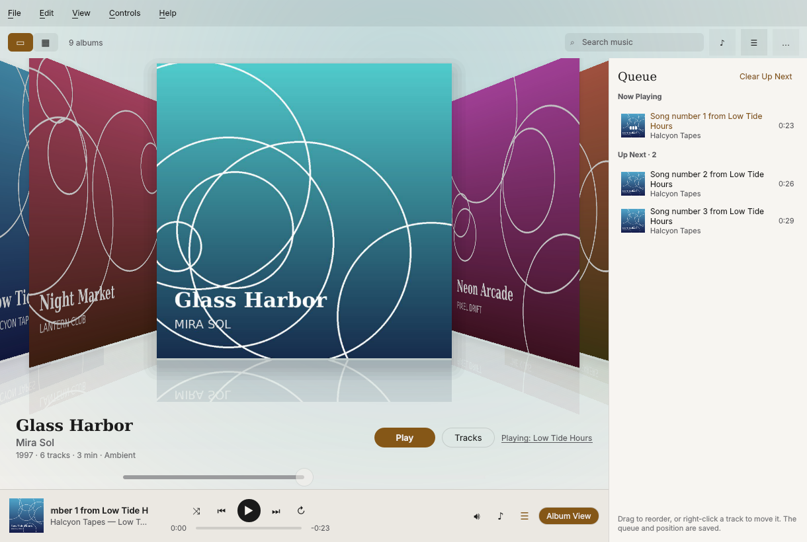

# Cover Flow for Windows

A Windows port of [Cover Flow](https://github.com/dustalexw/cover-flow), the macOS music
player built around browsing a record collection by its covers. It is written in C++ with
Qt 6 / QML, and uses FFmpeg for decoding and TagLib for tags, like the Mac app.



## Status

This is an early port (0.1). The core player is working; the Mac app's more specialised
features are being ported in rounds. See [docs/PORTING.md](docs/PORTING.md) for the full
parity checklist.

**Working now**
- Import files and folders (menu or drag and drop). Files stay where they are.
- The 3D Cover Flow (same geometry, spring and wheel/drag/touchpad rules as the Mac app)
  and a grid with marquee selection. Search and sort options.
- Album track panel coloured from the cover, Edit Album Info, Replace or Find Artwork Online.
- Gapless playback of MP3, AAC/ALAC, FLAC, WAV, AIFF, Ogg, Opus, APE, WavPack, WMA, DSD
  and more through FFmpeg, with queue, shuffle, repeat, Play Next and Add to Queue. The
  queue and position are saved.
- Album View mini-player (Compact / Large / Immersive, keep on top, auto-hiding controls).
- Synced and plain lyrics: `.lrc` sidecars, imports, and LRCLIB search.
- Dark, light and system themes. Media keys while the window is focused.

## Download

Every push builds a Windows package on GitHub Actions: open the latest run of the
**Build** workflow and download the `Cover-Flow-Windows-x64` artifact. Unzip it anywhere
and run `CoverFlow.exe`. Windows 10 or 11, 64-bit.

## Where data lives

`%APPDATA%\CoverFlow\CoverFlow` holds `Library.json`, `Playback.json`, `Artwork\` and
`Lyrics\`, in the same formats as the Mac app. Settings are in the registry under
`HKEY_CURRENT_USER\Software\CoverFlow\CoverFlow`. Set `COVERFLOW_DATA_DIR` to keep data
somewhere else (handy for a portable copy).

## Building

Requirements: Visual Studio 2022, CMake 3.21+, Ninja, Qt 6.8 (MSVC 2022 64-bit, with
Qt Multimedia), and [vcpkg](https://vcpkg.io).

```powershell
cmake -S . -B build -G Ninja -DCMAKE_BUILD_TYPE=Release `
  -DCMAKE_TOOLCHAIN_FILE="$env:VCPKG_ROOT/scripts/buildsystems/vcpkg.cmake" `
  -DPKG_CONFIG_EXECUTABLE="$PWD/build/vcpkg_installed/x64-windows/tools/pkgconf/pkgconf.exe"
cmake --build build
ctest --test-dir build --output-on-failure
```

vcpkg builds TagLib and FFmpeg from `vcpkg.json` on the first configure (FFmpeg takes a
while). On Linux, the system packages work too (`qt6-*-dev`, `libtag1-dev`, `libav*-dev`),
which is how the tests also run in CI.

The tests cover the LRC parser and lyric storage, tag reading and album grouping,
Library.json compatibility with the Mac app, the LRCLIB/MusicBrainz client including
Retry-After handling, decoding and seeking, the queue rules, and real-time gapless
playback (skipped on machines without an audio device).
